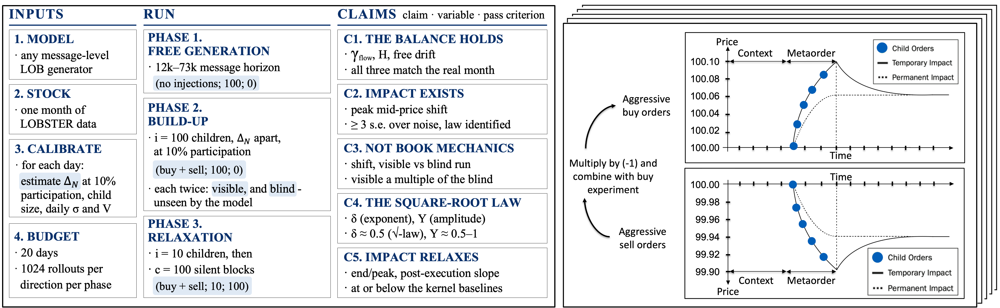

# lob_impact

Code for **LOB-Impact Benchmark: Emergent Market Impact in Generative Limit Order Book
Models**, oral at ACM ICAIF '26 (Milan).

George Nigmatulin, Valentin Mohl, Sascha Frey, Kang Li, Aramis Marti-Shahandeh,
Mihai Cucuringu, Anisoara Calinescu, Jakob Foerster, Stefan Zohren.

[Paper (arXiv:2610.27100)](https://arxiv.org/abs/2610.27100) ·
[Project page](https://george-nigmatulin.github.io/lob_impact/)



<details>
<summary>BibTeX</summary>

```bibtex
@inproceedings{nigmatulin2026lobimpact,
  title         = {{LOB-Impact Benchmark}: Emergent Market Impact in Generative
                   Limit Order Book Models},
  author        = {Nigmatulin, George and Mohl, Valentin and Frey, Sascha and Li, Kang
                   and Marti-Shahandeh, Aramis and Cucuringu, Mihai and Calinescu, Anisoara
                   and Foerster, Jakob and Zohren, Stefan},
  booktitle     = {Proceedings of the 7th ACM International Conference on AI in Finance
                   (ICAIF '26)},
  publisher     = {ACM},
  year          = {2026},
  doi           = {10.1145/3858063.3858909},
  eprint        = {2610.27100},
  archivePrefix = {arXiv},
  primaryClass  = {q-fin.TR}
}
```

</details>

**Does your generative limit-order-book model reproduce market impact?**

Distributional metrics, such as those of [LOB-Bench](https://github.com/peernagy/lob_bench),
answer whether generated order flow *looks* like the real stream.
They cannot answer whether the model *reacts* correctly when someone trades against it,
and a model used as a market simulator is used for exactly that. These tools measure the
reaction.

You generate rollouts with your own model, following the protocol below. The tools turn
them into the numbers that show whether the free run keeps the real stream's balance,
whether a metaorder moves the price, whether the model (rather than the book mechanics)
caused the move, how impact grows with executed volume, and whether the price relaxes
once execution stops.

## Install

```bash
git clone https://github.com/george-nigmatulin/lob_impact.git
cd lob_impact
python -m pip install -U pip       # editable installs need pip 21.3 or newer
pip install -e ".[test]"
pytest -q                          # end-to-end smoke test on synthetic data, about ten seconds
```

Python 3.9 or newer; NumPy, pandas, Matplotlib and PyYAML. `lob_impact` lists the
tools and `lob_impact <tool> --help` shows a tool's help (`python -m lob_impact.<tool>`
runs a tool the same way); a tool's full documentation (inputs, outputs, every cached key)
is in `python -m pydoc lob_impact.<tool>`.

## Try it on synthetic data

```bash
lob_impact synthetic --out /tmp/lob_impact_demo
export LOB_IMPACT_CONTROLS=/tmp/lob_impact_demo/controls LOB_IMPACT_GRID=/tmp/lob_impact_demo/grid \
       LOB_IMPACT_RESULTS=/tmp/lob_impact_demo/results
lob_impact flow_balance --stock XYZ --models ToyModel
lob_impact scorecard --stock XYZ
lob_impact trajectory build --stock XYZ --models Historic,ToyModel --shape beta
lob_impact points --stock XYZ --models Historic,ToyModel
lob_impact delta --stock XYZ --models Historic,ToyModel --daily /tmp/lob_impact_demo/daily_stats.csv
```

The toy data has a square-root impact path built in, so the build-up exponent comes out
near 0.5. It imitates no real market; it exists so that every tool has something to
measure.

## The protocol

Every rollout starts from a window of real messages that conditions the model. The model
then generates messages, which are replayed into an order-book simulator so that every
message comes with the book state after it.

**Phase 1: free run.** No intervention. Does the generated stream keep the balance of the
real one: long memory in trade signs, a diffusive price, no drift of its own?

**Phase 2: build-up.** A metaorder is injected: child market orders of a fixed size, all
in one direction, spaced by a fixed number of generated messages. The same generation is
run in two arms:

- **visible**: the child orders execute in the simulator, and the model conditions on them;
- **blind**: the child orders execute in the simulator, but the model never sees them.

The blind arm isolates the book mechanics; the difference between the arms is the part of
the response the model produced. Shape `beta` has 100 children and no cooling.

**Phase 3: relaxation.** Shape `relaxation` has 10 children followed by 100 cooling windows
of the same length without children. Does the price come back once execution stops?

Children are market orders (LOBSTER event type 4). Their size, the spacing between them
and the length of the conditioning window are yours to choose; keep them the same for every
model you compare, and for the reference arm. Run buy and sell metaorders (they are pooled
with the sign flipped) on many trading days: the exponent's confidence interval resamples
days.

## Input layout

```
$LOB_IMPACT_CONTROLS/
    noins/<STOCK>-<MODEL>-beta/{buy,sell}/exp_<run>/          free runs    (Phase 1)
    invisible/<STOCK>-<MODEL>-beta/{buy,sell}/exp_<run>/      blind arm    (Phase 2)
$LOB_IMPACT_GRID/
    <STOCK>-<MODEL>-beta/{buy,sell}/exp_<run>/                visible arm, build-up
    <STOCK>-<MODEL>-relaxation/{buy,sell}/exp_<run>/          visible arm, relaxation
```

Every `exp_<run>` directory (one or several per side; `<run>` is any name, and a single
run may also put its `data_gen/` straight into the side directory) holds

- `data_gen/<STOCK>_<YYYY-MM-DD>_message_real_id_<r>_gen_id_<g>.csv` and the matching
  `..._orderbook_...` file: one pair per rollout. The date in the file name is the trading
  day.
- in the arms with child orders, `aggressive_indices_<YYYY-MM-DD>.csv`: one integer per
  line, the 0-based row of each child order. All rollouts of a day share this schedule, so
  if several runs hold a file for the same day, the files must be identical.

The reference arm is called `Historic`: the real message stream of the same days, replayed
through the same pipeline (with the child orders inserted, in the metaorder arms). It is
read exactly like a model. A few names are historical and kept for compatibility: `beta`
is the build-up shape (the exponent itself is called delta), `invisible` holds the blind
arm, and `flow_balance` stores the reference arm under the key `Real`.

CSV files are headerless and follow LOBSTER:

- **message**: `time, event_type, order_id, size, price, direction`. Time in seconds after
  midnight; event type 4 is the execution of a visible order; direction is the side of the
  resting order (+1 buy, -1 sell), so a buyer-initiated trade has direction -1.
- **orderbook**: `ask_price_1, ask_size_1, bid_price_1, bid_size_1, ...`; row *i* is the
  book after message *i*. Prices are integers on a 100-unit tick (LOBSTER: dollars times
  10 000, one-cent tick). An empty side is written as 2147483647, or a price of 0 or less.

The build-up exponent also needs **daily statistics of the real stock**: a CSV with the
header `ticker,day,open_price,highest_price,lowest_price,close_price,execution_sum`, one row
per trading day, holding the first, highest, lowest and last execution price and the total
executed volume in shares (format details: `python -c "import lob_impact.vol; help(lob_impact.vol)"`).

Point the tools at the data with the environment variables `LOB_IMPACT_CONTROLS`, `LOB_IMPACT_GRID`
and `LOB_IMPACT_RESULTS`, with `config/paths.yaml` (copy `config/paths.example.yaml`), or with
each tool's path flags. `lob_impact paths` prints what was resolved.

## The tools

| phase | what it measures | command |
|---|---|---|
| 1 | trade-sign autocorrelation and its exponent, Hurst exponent of the mid, response to a trade | `lob_impact flow_balance --stock S --models M` |
| 1 | free drift | `lob_impact drift --stock S --models M` |
| 1 | response ratio R(100)/R(1), H on two lag bands, distances to the reference | `lob_impact scorecard --stock S` |
| 2, 3 | mean impact per message and per child | `lob_impact trajectory build --stock S --models Historic,M --shape beta` (and `--shape relaxation`) |
| 2, 3 | detection against three standard errors, horizon, end over execution | `lob_impact trajectory summary --cache <npz>` |
| 2 | visible arm against blind arm | `lob_impact triangle build --stock S --models M` |
| 2 | impact against executed volume, one point per child | `lob_impact points --stock S --models Historic,M` |
| 2 | build-up exponent with a day-clustered 95% interval | `lob_impact delta --stock S --models Historic,M --daily daily.csv` |
| 2, 3 | master curve, impact normalised at the end of execution | `lob_impact master_curve --stock S --models Historic,M --shape relaxation` |
| 3 | shape of the relaxation: rise, flat, decline, and its law where identifiable | `lob_impact decay_shape --stock S` |

Outputs land under `LOB_IMPACT_RESULTS`: caches as `.npz`, tables as Markdown. A tool whose own
gate fails reports that the quantity is not identified rather than printing a number: a
response that does not clear three standard errors, a fit without enough positive bins, a
bootstrap whose resamples are all undefined.

## Sampling and rollout length

**Sampling across trading days.** Rollout files sort by date, so the first N files cover
only the earliest trading days; for a model with many rollouts this can be a single day,
compared with a reference that spans the whole period. `flow_balance` and `drift` therefore
spread their sample evenly over trading days by default, and their tables report the number
of days and rollouts used.

**Rollout length.** The estimators fit over fixed lag windows: the sign autocorrelation over
lags of 2 to 40 trades, the price variance up to lag 100. Rollouts much shorter than about
ten times the longest lag leave these fits with few observations. Model and reference
rollouts should therefore have the same length; `--max_msgs` truncates every rollout to a
common length.

## Not included

- Model training and rollout generation: the tools take rollouts as input.
- Market data. LOBSTER data ([lobsterdata.com](https://lobsterdata.com)) is licensed
  separately and is not distributed here, in raw or derived form.
- The order-book simulator that turns generated messages into book states, for example
  [JAX-LOB](https://github.com/KangOxford/jax-lob).
- Distributional metrics: see [LOB-Bench](https://github.com/peernagy/lob_bench).

## Licence and citation

Apache License 2.0, see `LICENSE` and `NOTICE`. To cite the paper, use the BibTeX at the
top; the software citation is in `CITATION.cff`.
